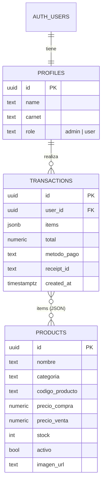

# 🛒 Tienda de Barrio

Aplicación móvil de punto de venta para una tienda de barrio, desarrollada con **React Native (Expo)** y **Supabase** como backend (base de datos PostgreSQL, autenticación, almacenamiento y tiempo real).

## Funcionalidades

**Cliente**
- Registro e inicio de sesión (sesión persistente).
- Catálogo con búsqueda y filtro por categoría, detalle de producto y stock en vivo.
- Carrito con control de stock, pago en efectivo o QR.
- Recibo digital en PDF (compartible) e historial de compras.

**Administrador**
- Inventario: crear, editar y dar de baja productos (con foto), código de producto automático, alerta de stock bajo.
- Reportes: ingresos totales, ganancia real, gráfico de ventas por día, historial con búsqueda por carnet / recibo y filtro por fechas.
- Detalle y reimpresión de cualquier recibo.

**General:** tema claro/oscuro, actualización en tiempo real de productos y ventas.

## Arquitectura

```
app/                 Pantallas (Expo Router)
  _layout.tsx        Proveedores + rutas protegidas por sesión
  (auth)/login.tsx   Inicio de sesión / registro
  (tabs)/productos   Catálogo (cliente) · Inventario (admin)
  (tabs)/ventas      Carrito e historial (cliente) · Reportes (admin)
context/             Estado global
  AuthContext        Sesión de Supabase + perfil (rol admin/user)
  ProductContext     Productos (CRUD + Realtime)
  CartContext        Carrito validado contra el stock
  TransactionContext Compras y recibos (función SQL atómica)
  ThemeContext       Tema claro / oscuro
utils/               Formato, errores en español, subida de imágenes
supabase.ts          Cliente de Supabase (lee el archivo .env)
supabase/setup.sql   RLS, triggers, función de compra, bucket y realtime
```

### Modelo de datos



### Decisiones técnicas (para la defensa)

| Tema | Decisión |
|---|---|
| **Seguridad** | RLS en todas las tablas: el cliente solo ve sus compras y solo el admin modifica productos. El rol se asigna en el servidor (trigger), nunca desde la app. |
| **Compra atómica** | La función SQL `realizar_compra` valida stock, bloquea filas, descuenta inventario y genera el recibo en una sola transacción: evita sobreventa y manipulación de precios. |
| **Sesión** | Se guarda en AsyncStorage y las rutas se protegen con `Stack.Protected` de Expo Router. |
| **Imágenes** | Se suben a Supabase Storage (antes se guardaba una ruta local que solo existía en el teléfono del admin). |
| **Baja lógica** | Eliminar un producto solo lo oculta (`activo = false`) para conservar el historial de ventas. |
| **Configuración** | URL y clave pública en `.env` (variables `EXPO_PUBLIC_*`); la `service_role` key nunca va en la app. |

## Instalación

Requisitos: **Node.js 20.19 o superior (recomendado 22 LTS)** y la app **Expo Go** en el teléfono.

```powershell
# 1. Entrar a la carpeta del proyecto
cd C:\proyectos_limpios\mi-aplicacion-de-tienda

# 2. Instalar dependencias (esto crea la carpeta node_modules)
npm install

# 3. Variables de entorno: copia .env.example a .env y completa tus datos
copy .env.example .env

# 4. Iniciar (la primera vez, con -c para limpiar la caché)
npx expo start -c
```

> Si ves el aviso *"The global expo-cli package has been deprecated"*, desinstala la versión global: `npm uninstall -g expo-cli`. Siempre usa `npx expo ...`, que ejecuta la versión del proyecto.

### Configurar Supabase (una sola vez)

1. En Supabase abre **SQL Editor**, pega el contenido de [`supabase/setup.sql`](supabase/setup.sql) y ejecútalo.
2. Regístrate en la app y luego vuelve al SQL Editor para convertirte en administrador:
   ```sql
   update public.profiles
      set role = 'admin'
    where id = (select id from auth.users where email = 'tu-correo@ejemplo.com');
   ```
3. (Opcional) En *Authentication → Providers → Email* puedes desactivar "Confirm email" para probar más rápido.

## Versión de Expo

El proyecto usa **Expo SDK 54**, que es la versión compatible con la app Expo Go de la App Store. Para comprobar que todo esté alineado:

```powershell
npx expo install --fix     # ajusta las dependencias a las versiones del SDK
npx expo-doctor            # diagnóstico del proyecto
```

Para subir de SDK, hazlo de a una versión: [guía oficial](https://docs.expo.dev/workflow/upgrading-expo-sdk-walkthrough/). Ojo: la app Expo Go de las tiendas solo soporta ciertas versiones del SDK; revisa [expo.dev/go](https://expo.dev/go) antes de actualizar.

## Scripts

| Comando | Qué hace |
|---|---|
| `npm start` | Inicia el servidor de desarrollo |
| `npm run typecheck` | Revisa los tipos de TypeScript |
| `npm run lint` | Revisa el estilo del código |
| `npm run doctor` | Diagnóstico de Expo |

## Problemas frecuentes

| Síntoma | Solución |
|---|---|
| `Unable to find expo in this project` | Falta instalar dependencias: ejecuta `npm install` dentro de la carpeta del proyecto. |
| `Faltan EXPO_PUBLIC_SUPABASE_URL...` | Crea el archivo `.env` (ver `.env.example`) y reinicia con `npx expo start -c`. |
| La compra falla con "permission denied" | Ejecuta `supabase/setup.sql` completo (crea la función `realizar_compra`). |
| La foto del producto no se sube | Verifica que exista el bucket `product-images` (lo crea `setup.sql`). |
| Un usuario nuevo no tiene rol | Revisa que exista el trigger `on_auth_user_created` (en `setup.sql`). |
